# 🌤️ Meteocat Card

[](https://opensource.org/licenses/Apache-2.0)

[](https://www.home-assistant.io/integrations/marketplace/)
[](https://github.com/figorr/meteocat-card/actions/workflows/validate.yaml)
[](https://github.com/figorr/meteocat-card/actions/workflows/release.yml)


Custom Lovelace card for Home Assistant to display weather data from the [Meteocat integration](https://github.com/figorr/meteocat).  
Supports animated or static icons with day/night variants, and shows hourly and daily forecasts.

## Installation

Starting with Home Assistant 2026.11, [HACS is built into Home Assistant as the Marketplace](https://www.home-assistant.io/integrations/marketplace/). On Home Assistant 2026.10 or older, use the HACS instructions below.

### Marketplace (Home Assistant 2026.11 or newer)

#### From the catalog

1. Go to **Settings > Marketplace**.
2. Search for **Meteocat Card** and open its repository page.
3. Select **Install**.
4. Refresh Lovelace and your browser.

#### Using a custom repository

Use this only if **Meteocat Card** is not available in the Marketplace catalog.

1. Go to **Settings > Marketplace**.
2. Select **Add from link** and enter `https://github.com/figorr/meteocat-card`.
3. Select **Add**. A GitHub connection is required for custom repositories.
4. Open the **Meteocat Card** repository and select **Install**.
5. Refresh Lovelace and your browser.

### HACS (Home Assistant 2026.10 or older)

1. Open **HACS**.
2. Search for **Meteocat Card** and install it.
3. Refresh Lovelace and your browser.

### Manual
1. Download the `meteocat-card.zip` file from the latest release. 

2. Unzip the file.

3. Copy the compiled file `meteocat-card.js` and `meteocat-card-editor.js` to your Home Assistant `www` folder, preferably in a subfolder for organization:
   
   ```text
   /config/www/meteocat-card/meteocat-card.js
   /config/www/meteocat-card/meteocat-card-editor.js
   ```

4. Copy the `icons` folder included in the release to your Home Assistant setup at:

   ```text
   /config/www/meteocat-card/icons/
   ```

5. Add the resource to your Lovelace configuration:

   Go to **Settings > Dashboards > Resources > Add Resource**

   ```yaml
   url: /local/meteocat-card/meteocat-card.js
   type: module
   ```

   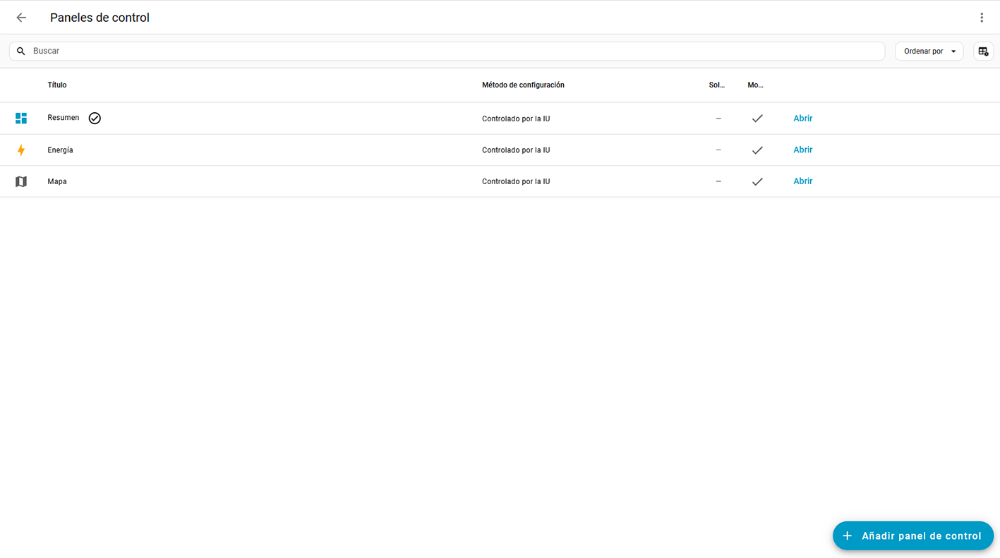

   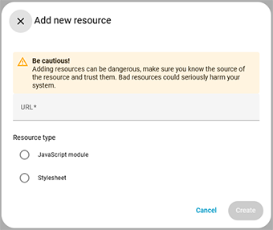

   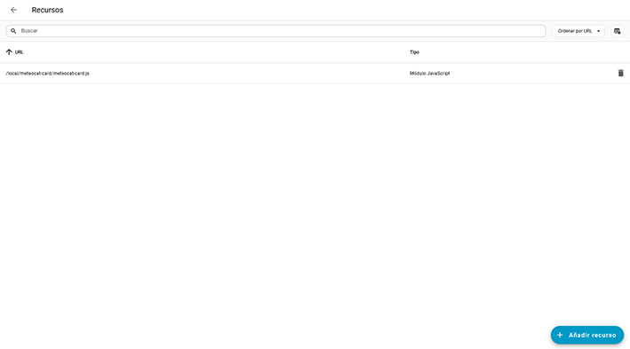

6. Refresh or hard refresh your web browser.

   #### 6.1 To perform a refresh
   ##### - On Windows and Linux
   - Ctrl + F5
     : This is the universal shortcut for a hard refresh in most browsers. 
   - Ctrl + Shift + R
     : This is another common shortcut for a hard refresh. 
   - Ctrl + Click the Reload Button
     : You can hold the Ctrl key and click the browser's reload icon to achieve the same result.

   ##### - On Mac
   - Command + Shift + R
     : For Chrome, Firefox, and Edge, use this shortcut to force a refresh. 
   - Shift + Click the Reload Button
     : In Safari, you can hold the Shift key and click the reload icon to bypass the cache. 
   - Command + Option + E then Reload
     : For a hard refresh in Safari, first press Command + Option + E to empty the cache, then click the Reload button in the toolbar.

   #### 6.2 Delete navigation data
   Sometimes a refresh is not enough and it is mandatory to delete the navigation data from the web browser. Please take a look at the Wiki [Troubleshooting](https://github.com/figorr/meteocat-card/wiki/Troubleshooting)

## Icon Path Setup

The card needs to know the path to its custom icons. The path depends on how you installed the card. The default is **Marketplace installation**.

In the visual editor, pick **Marketplace installation** or **Manual installation** and the card will set the proper icon path.

When using the code editor, **Marketplace installation** is the default option.

You can edit the icon path if you placed the icons somewhere else. Change **iconPath** in the card YAML.

### Marketplace installation:

`/local/community/meteocat-card/`

Marketplace installs the icons in the same folder as the card. Existing configurations using `icon_path_type: hacs` or an `/hacsfiles/...` path are migrated automatically to the equivalent `/local/...` path.

### Manual installation:

`/local/meteocat-card/icons/`

or which is the same:

`/config/www/meteocat-card/icons/`

#### Visual editor example

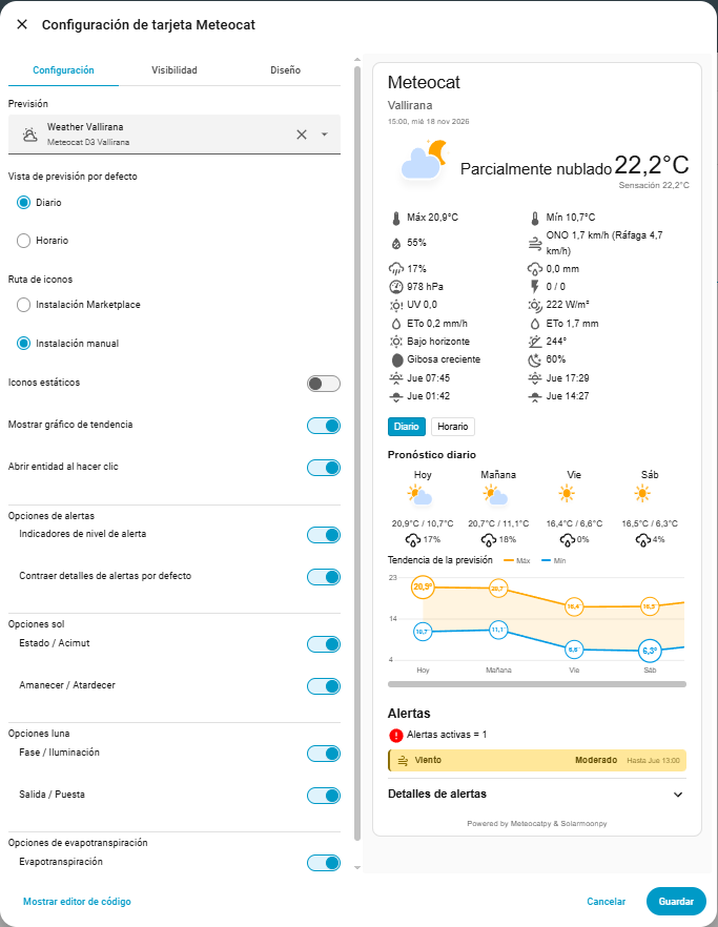

#### Code editor example

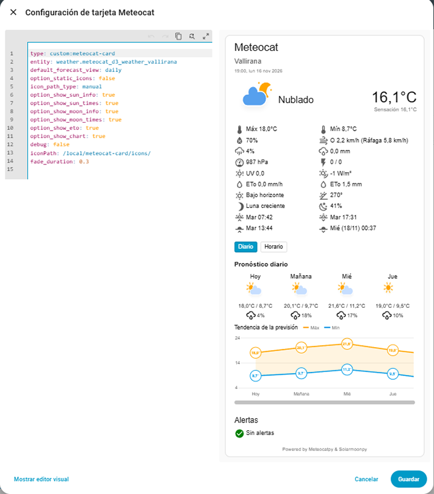

## Icon Setup

- a- prefix → animated icons (e.g., a-clear-day.svg)
- s- prefix → static icons (e.g., s-clear-day.svg)
- -day suffix → daytime icon
- -night suffix → nighttime icon
- clear-night ignores the day/night suffix

Example icons:
```css
a-clear-day.svg
a-clear-night.svg
s-rainy-day.svg
s-rainy-night.svg
```

## Configuration

### Pick the card

   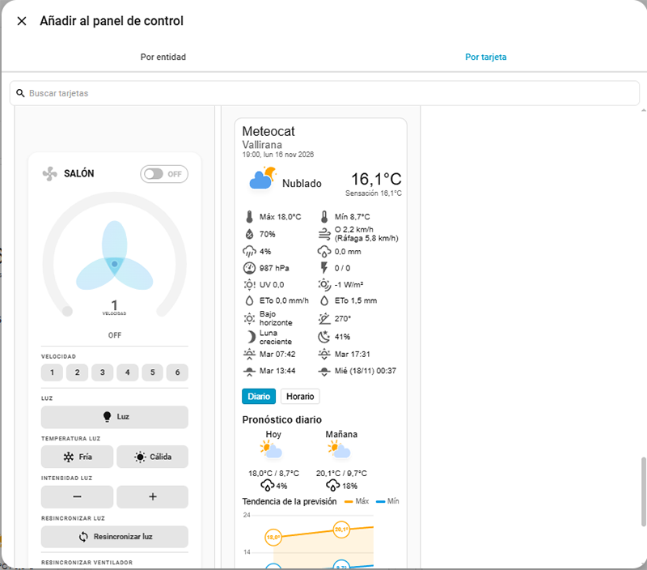

### Using your Meteocat Weather Entity

   Use your Meteocat Weather entity to get full functionality including current conditions, hourly and daily forecasts.

   You can use **visual editor** and **code editor** to configure your card.

   #### (a) Visual editor setup

   - The visual setup is an easy way to configure your card.

      #### Visual editor example

      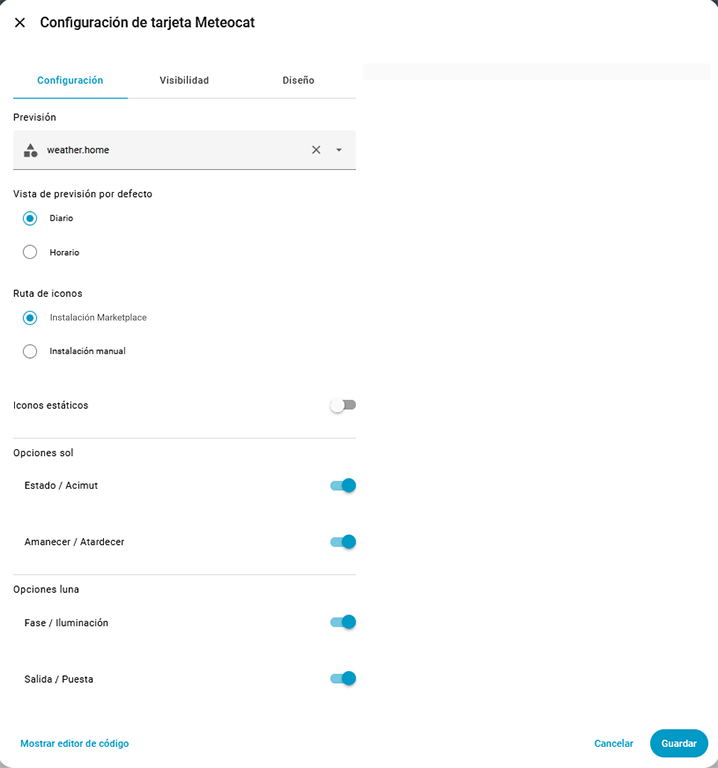

      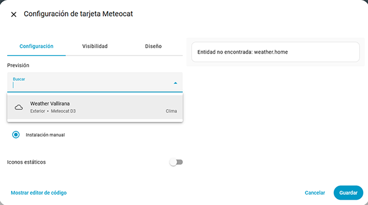

      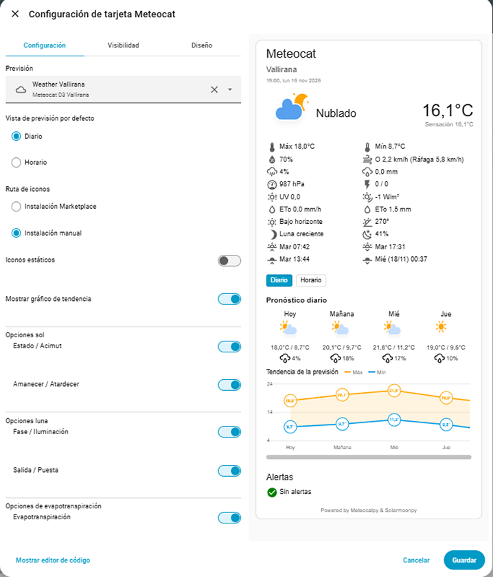

   - And **save**

   - Sometimes the alerts are not inmediately being shown so you need to perform a refresh at your lovelace or web browser, as explained above.

   #### (b) Code editor setup

   ```yaml
   type: custom:meteocat-card
   entity: weather.home
   default_forecast_view: daily
   option_static_icons: false  # set true for static icons
   icon_path_type: marketplace
   iconPath: /local/community/meteocat-card/
   option_show_sun_info: true
   option_show_sun_times: true
   option_show_moon_info: true
   option_show_moon_times: true
   option_show_chart: false
   debug: false
   fade_duration: 0.3
   ```

   - entity: Your Meteocat Weather entity (e.g., weather.meteocat_yourtown)
   - option_static_icons: true for static icons, false for animated icons

     The card automatically selects the correct icon based on the current condition and time of day.

      #### Code editor example

      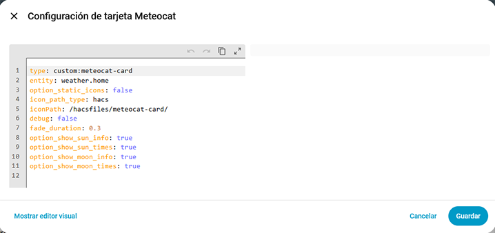

      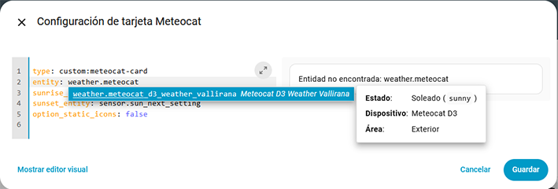

      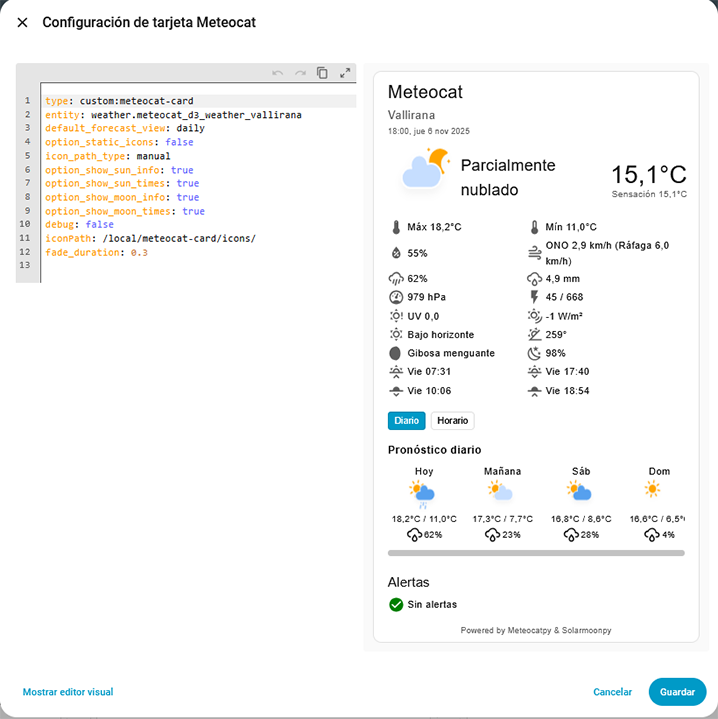

      ```yaml
      type: custom:meteocat-card
      entity: weather.meteocat_station_id_weather_town_name
      default_forecast_view: daily
      option_static_icons: false
      icon_path_type: manual
      iconPath: /local/meteocat-card/icons/
      option_show_sun_info: true
      option_show_sun_times: true
      option_show_moon_info: true
      option_show_moon_times: true
      option_show_chart: false
      debug: false
      fade_duration: 0.3
      ```

   **The card shows:**

   - Current weather condition and icon
   - Temperature, humidity, pressure, wind speed, bearing, gust, precipitation, precipitation probability, uv index, sunset* and sunrise*
   - Daily forecast
   - Hourly forecast

## Configuration Options

| Option                   | Type    | Default                           | Description                                                |
|--------------------------|-------- |-----------------------------------|------------------------------------------------------------|
| `entity`                 | string  | —                                 | **Required.** Your Meteocat weather entity.                |
| `default_forecast_view`  | boolean | `daily`                           | Use daily view (`daily`) or hourly view (`hourly`).        |
| `option_static_icons`    | boolean | `false`                           | Use static icons (`true`) or animated icons (`false`).     |
| `option_show_chart`      | boolean | `false`                           | Use `true` to show the forecast trend chart.               |
| `icon_path_type`         | string  | `marketplace`                     | Use `marketplace` or `manual` according to your installation. Legacy `hacs` is migrated automatically. |
| `iconPath`               | string  | `/local/community/meteocat-card/` | Path to the folder containing the SVG icons.          |
| `option_show_sun_info`   | boolean | `true`                            | Use `false` to disable sun info sensors.                   |
| `option_show_sun_times`  | boolean | `true`                            | Use `false` to disable sunrise and sunset sensors.         |
| `option_show_moon_info`  | boolean | `true`                            | Use `false` to disable moon info sensors.                  |
| `option_show_moon_times` | boolean | `true`                            | Use `false` to disable moonrise and moonset sensors.       |
| `debug`                  | boolean | `false`                           | Use `true` to enable debug.                                |
| `fade_duration`          | float   | `0.3`                             | Value between `0.0` and `1.0` for transition daily/hourly. |

### Forecast trend chart

Set `option_show_chart: true` to display a trend chart below the forecast cards and above the slider. The chart follows the selected forecast view and moves together with the forecast cards, keeping 4 items visible on desktop and 3 on mobile.

- **Daily view:** maximum and minimum temperature lines.
- **Hourly view:** temperature line and precipitation bars in mm for the next 72 hours.

## Notes

- Make sure your Meteocat integration provides a Weather entity (not just individual sensors) to get full card functionality.
- The card dynamically determines day or night icons.
- For best results, keep your icons folder updated with the latest icons from the repo.

## Examples

### Basic Usage

```yaml
type: custom:meteocat-card
entity: weather.meteocat_station_id_weather_town_name
default_forecast_view: daily
option_static_icons: false
icon_path_type: marketplace
iconPath: /local/community/meteocat-card/
option_show_sun_info: true
option_show_sun_times: true
option_show_moon_info: true
option_show_moon_times: true
option_show_chart: false
debug: false
fade_duration: 0.3
```

### Using Animated Icons

```yaml
type: custom:meteocat-card
entity: weather.meteocat_station_id_weather_town_name
default_forecast_view: daily
option_static_icons: false
icon_path_type: marketplace
iconPath: /local/community/meteocat-card/
option_show_sun_info: true
option_show_sun_times: true
option_show_moon_info: true
option_show_moon_times: true
debug: false
fade_duration: 0.3
```

### Using Static Icons

```yaml
type: custom:meteocat-card
entity: weather.meteocat_station_id_weather_town_name
default_forecast_view: daily
option_static_icons: true
icon_path_type: marketplace
iconPath: /local/community/meteocat-card/
option_show_sun_info: true
option_show_sun_times: true
option_show_moon_info: true
option_show_moon_times: true
debug: false
fade_duration: 0.3
```

### Example Display

#### Current Weather:

(a) No alerts


(b) 1 alert

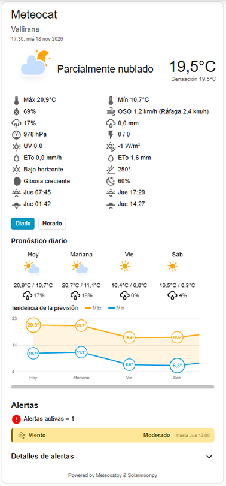

(c) 2 alerts

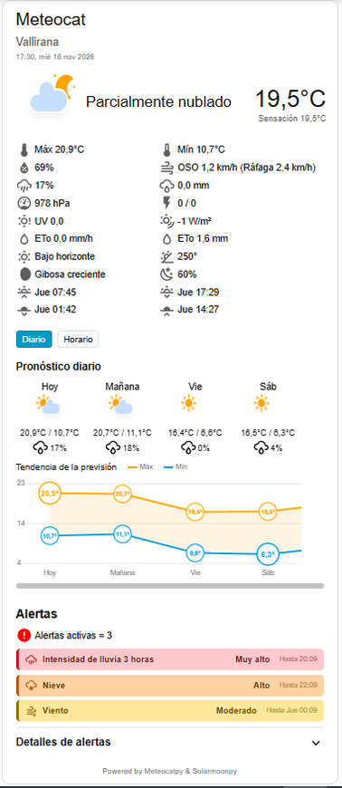

#### Daily Forecast:

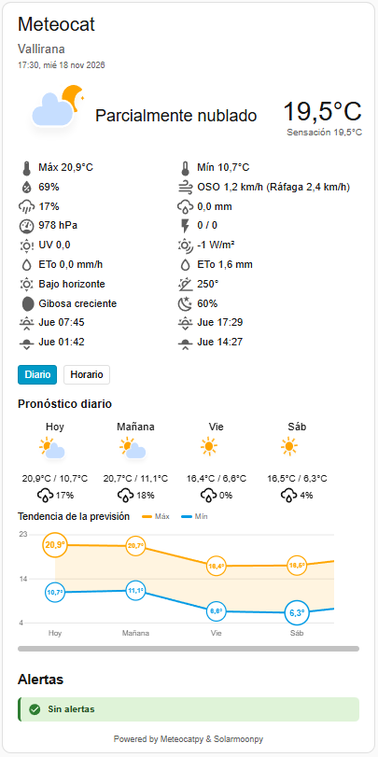

#### Hourly Forecast:

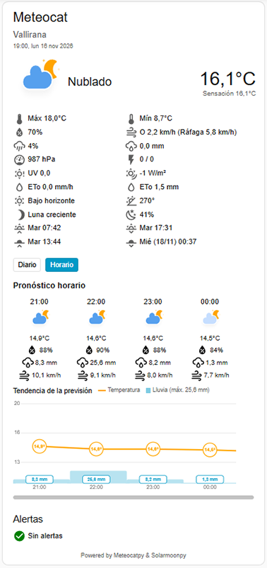

## Features

- ✅ Display temperature, humidity, wind speed, and precipitation among other
- ✅ Shows a weather icon according to the condition and time of day
- ✅ Supports animated (a-) or static (s-) icons
- ✅ Displays hourly and daily forecasts when using a Weather entity
- 🚧 Lightweight and compatible with Home Assistant 2025+
- 🛠️ Early stage — more features will be added (styling, additional forecasts, etc.)

## Uninstalling Meteocat Card

To remove the Meteocat Card follow the guidelines from Wiki [Uninstallation](https://github.com/figorr/meteocat-card/wiki/Uninstallation)

## Troubleshooting

FAQ and common issues are solved in the Wiki.

Please take a look at [Troubleshooting](https://github.com/figorr/meteocat-card/wiki/Troubleshooting)


## Contributing to Meteocat Card

Thanks for your interest in contributing! 🚀

We welcome contributions in any form: bug reports, new features, or improvements to documentation.

### How to Contribute

1. **Check existing issues and discussions**  

   See if your idea or bug has already been reported:
   - [Issues](https://github.com/figorr/meteocat-card/issues)
   - [Discussions](https://github.com/figorr/meteocat-card/discussions)

2. **Fork the repository**  

   Click the "Fork" button at the top-right of this repository.

3. **Set up your development environment**

   ```bash
   git clone https://github.com/figorr/meteocat-card.git
   cd meteocat-card
   npm install
   ```

4. **Start developing**

- The main code is in src/meteocat-card.js.
- The editor code is in src/meteocat-card-editor.js
- You can use a local dev server (e.g., npm run watch) to see changes live in Home Assistant.

5. **Lint and test your code**

     ```bash
     npm run lint
     npm run test
     ```

     Make sure your code passes linting and tests before committing.

6. **Add yourself to `AUTHORS.md`.**

7. **Update `README.md`.** 

     Just update the `README.md` with any new documentation if your development includes new features for the card.

7. **Commit your changes**

     ```bash
     git add .
     git commit -m "feat: describe your change"
     git push origin your-branch
     ```

8. **Submit a Pull Request**

- Open a PR from your branch to the master branch of this repository.
- Describe your changes clearly and link any relevant issues.

## Code Style

- Use ES6+ syntax.
- Prefer const/let over var.
- Keep code modular and readable.
- Follow Prettier formatting (if configured).

## License

[Apache-2.0](LICENSE). By providing a contribution, you agree the contribution is licensed under Apache-2.0.
